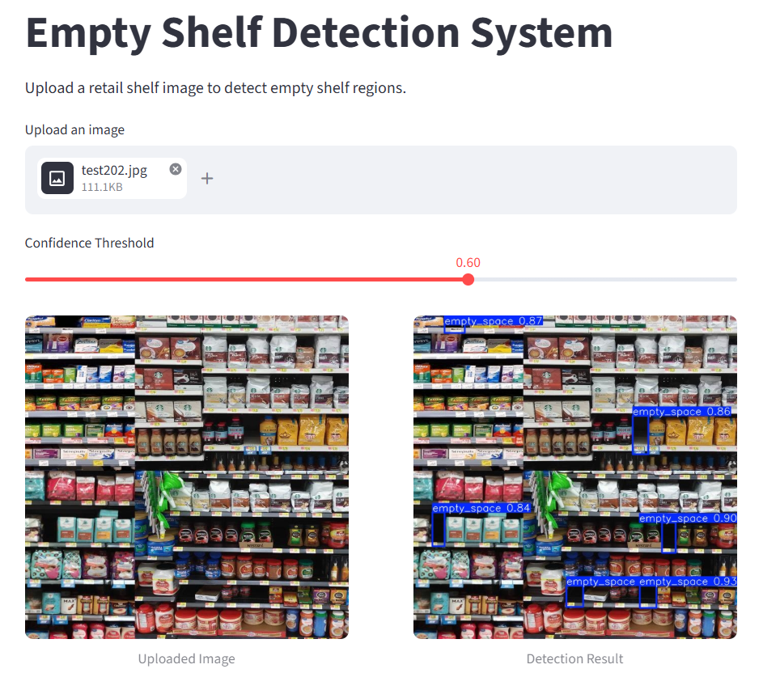

# 🛒 Empty Shelf Detection System

A computer vision project for detecting empty shelf spaces in supermarket environments using YOLO26.

The system identifies empty areas on retail shelves and visualizes detected regions with bounding boxes. The project covers the complete machine learning workflow, from dataset preparation and model training to local application deployment.

## 📌 Overview

Empty shelf detection is an important task in retail automation. Identifying unoccupied shelf spaces can help retailers monitor product availability and improve inventory management.

This project uses an object detection approach based on YOLO26 to identify empty shelf regions in images.

## ✨ Key Features

- Detection of empty shelf spaces in supermarket images.
- YOLO26-based object detection.
- Custom dataset preparation and augmentation using Roboflow.
- Model training and evaluation in Google Colab.
- Interactive web interface built with Streamlit.
- Visualization of detection results with bounding boxes.

## 🛠️ Technology Stack

| Technology   | Purpose                              |
| ------------ | ------------------------------------ |
| Python       | Main programming language            |
| YOLO26       | Object detection model               |
| Ultralytics  | Model training and inference         |
| Roboflow     | Dataset management and preprocessing |
| OpenCV       | Image processing                     |
| Google Colab | Model training                       |
| Streamlit    | Web application                      |
| PyTorch      | Deep learning framework              |

## 📂 Dataset

The project uses the **Supermarket Empty Shelf Detector** dataset from Roboflow.

- Dataset: `supermarket-empty-shelf-detector`
- Version: 2
- Annotation format: YOLO26
- Number of classes: 1
- Class name: `empty_space`

The dataset was used for training and evaluating the object detection model.

## 🧠 Model Training

The model was trained using YOLO26 on a Tesla T4 GPU in Google Colab.

The training workflow included:

1. Dataset download and preparation.
2. Data preprocessing and augmentation experiments.
3. Model training.
4. Model evaluation.
5. Error analysis and visualization of results.

Different training configurations were compared to investigate the impact of data augmentation on model performance.

## 📊 Model Evaluation

The trained model was evaluated using standard object detection metrics:

- **Precision** — measures how many predicted detections are correct.
- **Recall** — measures how many actual empty shelf spaces are detected.
- **mAP\@50** — evaluates detection performance at an IoU threshold of 0.5.

Evaluation also included confusion matrix analysis and visualization of precision, recall, F1-score, and precision-recall curves.

## 💻 Application

The project includes a local web application developed with Streamlit.

Users can:

1. Upload a supermarket shelf image.
2. Adjust the confidence threshold.
3. Run the object detection model.
4. View the original image and detection results side by side.

The application displays detected empty shelf regions using bounding boxes.

### Application Preview



## 🚀 Installation

### 1. Clone the repository

```bash
git clone https://github.com/aibat-mz/Empty-Shelf-Detection.git
cd Empty-Shelf-Detection
```

### 2. Create a virtual environment

```bash
python -m venv venv
```

Activate it on Windows:

```bash
venv\Scripts\activate
```

### 3. Install dependencies

```bash
pip install -r requirements.txt
```

### 4. Add model weights

Place the trained model weights file (`best.pt`) in the project root directory.

## ▶️ Usage

Run the Streamlit application:

```bash
streamlit run app.py
```

The application will open in your browser.

Upload an image and explore the detection results.

## 📁 Project Structure

```text
Empty-Shelf-Detection/
│
├── assets/
│   └── screenshots/
│       └── demo.png
│
├── app.py
├── best.pt
├── requirements.txt
├── train.ipynb
└── README.md
```

## 🔮 Future Improvements

- Expand the dataset with more diverse supermarket environments.
- Improve detection under different lighting conditions and camera angles.
- Experiment with additional data augmentation strategies.
- Optimize inference speed for real-time applications.
- Explore integration with retail inventory monitoring systems.
